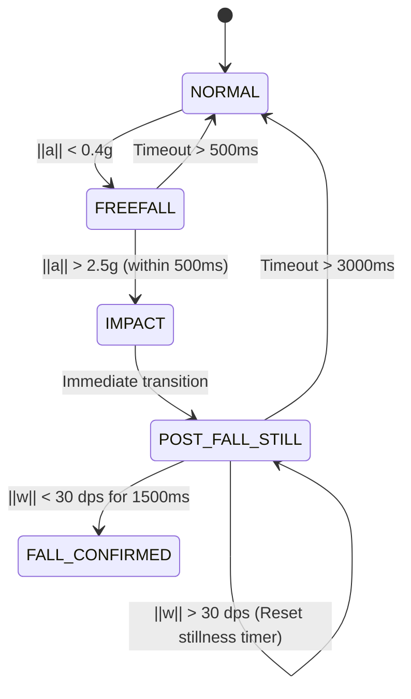

# Presentation Notes: Fall Detection Core (Sensing Module)

This document provides talking points, technical explanations, empirical performance metrics, and architecture details for presenting the **Sensing & Fall Detection Core** in class.

---

## 1. Executive Summary & Module Scope

- **Role**: Person A — Motion sensing and fall classification logic (`/sensing/`).
- **Hardware Integration**: MPU6050 6-axis IMU (3-axis Accelerometer + 3-axis Gyroscope) communicating over I2C to ESP32 DevKit V1.
- **Output Interface**: Exposes a clean, single-shot C++ interface (`FallDetector`) to the main firmware. Once `FALL_CONFIRMED` is reached, `fallDetected()` returns `true` once to trigger the 10-second grace period and alert system.

---

## 2. The 4-Stage State Machine Algorithm

The classifier relies on a state machine evaluating total acceleration magnitude $\|a\| = \sqrt{a_x^2 + a_y^2 + a_z^2}$ and angular velocity magnitude $\|\omega\| = \sqrt{\omega_x^2 + \omega_y^2 + \omega_z^2}$.

### Stage Breakdown:
1. **`NORMAL` $\rightarrow$ `FREEFALL` (Freefall Dip)**:
   - **Trigger**: Accel magnitude drops below `freefall_g` (**0.4g**, tuned **0.3g**).
   - **Physics**: In a true fall, a body briefly enters weightlessness before collision.
   - **Timeout**: Must observe impact within `freefall_to_impact_ms` (**500ms**); otherwise, it was just a transient arm dip and bails back to `NORMAL`.

2. **`FREEFALL` $\rightarrow$ `IMPACT` (Collision Spike)**:
   - **Trigger**: Accel magnitude spikes above `impact_g` (**2.5g**, tuned **2.0g**).
   - **Physics**: Rapid deceleration occurring when the wrist/body impacts the ground.

3. **`IMPACT` $\rightarrow$ `POST_FALL_STILL` (Impact-Settle Phase)**:
   - **Trigger**: Immediate state transition upon impact.
   - **Buffer**: Applies `impact_settle_ms` (**150ms**) buffer before evaluating stillness.

4. **`POST_FALL_STILL` $\rightarrow$ `FALL_CONFIRMED` (Post-Fall Stillness Qualification)**:
   - **Trigger**: Angular velocity remains below `stillness_gyro_dps` (**30.0 dps**, tuned **20.0 dps**) continuously for `stillness_window_ms` (**1500ms**, tuned **1000ms**).
   - **Physics**: Unconscious or injured victim lying immobile post-impact.

---

## 3. Why the Impact-Settle Buffer Exists (The False-Negative Bug Fix)

> [!IMPORTANT]
> **Key Technical Highlight for Presentation**: The `impact_settle_ms = 150ms` buffer addresses a critical false-negative bug discovered during initial state machine design.

### The False-Negative Bug:
When a wristband impacts the floor, the hard collision transfers rotational kinetic energy into the sensor housing, producing a brief, high-amplitude angular velocity spike ($||\omega|| > 100\text{ dps}$) lasting 50ms–120ms immediately following impact.

- **Without Settle Buffer**: If the classifier starts evaluating post-fall stillness immediately at $t = t_{\text{impact}}$, the impact recoil spike exceeds the 30 dps gyro threshold. The classifier interprets this recoil as "the user is still moving around normally" and either resets the stillness timer or bails back to `NORMAL`.
- **Result**: The system failed to confirm genuine falls (**False Negative**).

### The Solution:
By enforcing `impact_settle_ms = 150ms`, the classifier explicitly ignores kinetic gyro noise resulting directly from the collision impact itself. Stillness timing (`stillness_start_ms_`) is only evaluated after mechanical vibration settles, eliminating false negatives.

---

## 4. Current Performance Metrics (Grid-Search Tuning Sweep)

Using `tune_thresholds.py` to grid-search threshold combinations across 60 synthetic scenario iterations (15 fall traces, 45 non-fall traces):

| Metric | Score | Details |
| :--- | :--- | :--- |
| **Sensitivity** | **100.00%** | $15 / 15$ real fall traces correctly flagged |
| **Specificity** | **100.00%** | $45 / 45$ non-fall traces correctly rejected |
| **Balanced Accuracy**| **100.00%** | Baseline performance across synthetic dataset |

### Default vs. Grid-Search Optimized Thresholds:

| Threshold Parameter | Baseline (`fall_detector.h`) | Grid-Search Best Candidate |
| :--- | :--- | :--- |
| `freefall_g` | `0.4f` | `0.3f` |
| `impact_g` | `2.5f` | `2.0f` |
| `freefall_to_impact_ms` | `500 ms` | `500 ms` |
| `stillness_gyro_dps` | `30.0f` | `20.0f` |
| `stillness_window_ms` | `1500 ms` | `1000 ms` |
| `impact_settle_ms` | `150 ms` | `150 ms` |

---

## 5. Known Limitations & Real-Hardware Roadmap

> [!WARNING]
> **Synthetic Data Disclaimer**: 100% sensitivity and specificity on synthetic data is a required sanity check, but NOT proof of real-world perfection.

### Unmodeled Real-World Distorted Motions:
1. **Taking Off Wristband**: Slapping the wristband down hard on a nightstand (freefall dip + hard impact + stillness).
2. **Vehicular Motion**: Getting into a car, riding a bicycle over bumps, or abrupt transit braking.
3. **Gesturing**: Dropping arm quickly while speaking or sitting down rapidly into a couch.

### Hardware Testing Roadmap:
1. **Phase 1 (Hardware Sanity Check)**: Flash ESP32, confirm MPU6050 I2C ACK, verify static $1.0\text{g}$ gravity vector on Z-axis.
2. **Phase 2 (Real Trace Logging)**: Log raw IMU CSV traces for real arm swings, sitting, and controlled drop-tests onto pads.
3. **Phase 3 (Re-Tuning)**: Add real-world CSV traces into `synthetic_fall_data.py` and re-run `tune_thresholds.py`.
